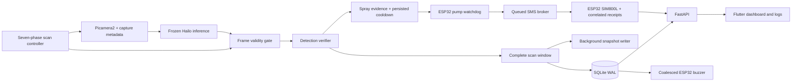

# FarmCam system overview

## Architecture

The coordinator receives the running server module explicitly. Importing a second `main` module is unnecessary. Routes register once when the application is constructed; services start only after camera/model initialization succeeds. Partial startup failures stop initialized workers. Unfinished scan records are marked aborted on restart.

## Scan timing and frame attribution

Each station follows:

`DETECT_UPPER (30s) → TRANSIT_TO_LOWER (5s) → SETTLING (1s) → DETECT_LOWER (30s) → TRANSIT_TO_UPPER (5s) → MOVING_TO_STATION (10s, or 15s after station 4) → SETTLING (1s)`.

The nominal four-station cycle is:

`T = 4 × (30 + 5 + 1 + 30 + 5 + 1) + 3 × 10 + 15 = 333 seconds`.

The first startup begins at station 1 upper position. Actual elapsed time can include loop scheduling and model-switch overhead. The timers represent the existing mechanical scan sequence; this software does not add motor drivers or position feedback. Align physical motion with the schedule before enabling automatic operation.

Every camera acquisition receives immutable sequence, monotonic capture time, station, position, phase, and scan ID metadata. Capture is stamped before acquiring the frame, conservatively rejecting a capture spanning a transition. The controller advances even when no frames arrive. Inference is suppressed during transit and settling. Results finishing after their window are discarded.

## Verification

The original inference/postprocessing functions are frozen; their source hashes are tested. Verification runs downstream:

- **Confidence:** class confidence must meet the configured class threshold.
- **Geometry:** bounding-box area `A=(x2-x1)(y2-y1)` and aspect ratio `r=(x2-x1)/(y2-y1)` must satisfy class limits. Fungus has its existing aspect-ratio exemption.
- **Skin:** reject pests when the YCrCb skin-pixel ratio in the crop exceeds `SIGMA_MAX`, or suppress pests for a hand-dominated frame. Fungus is evaluated separately.
- **Whitefly context:** the surrounding ring must meet `GREEN_RATIO_MIN`; crop brightness and saturation must meet the configured whitefly limits.
- **Temporal confirmation:** accept a track after the configured observation duration or K recent observations. Centroid speed `sqrt(dx²+dy²)/dt` must not exceed `CENTROID_DRIFT_MAX`. Only candidates matched in the current frame are returned; unmatched or rejected tracks are not replayed.

Normalized station/position ROIs additionally restrict accepted centers. Tune physical thresholds with representative images using the existing calibration tools. Exceptions disable automatic actuation rather than passing unverified detections through.

## Persistence and snapshots

`data/farmcam.db` uses SQLite WAL. `scans` stores station, position, timing, and completion status; `tracks` stores class, geometry, confidence, coverage, lifecycle, review, and snapshot references; `cooldowns` stores actuator timestamps. Existing legacy `detection_logs.db` remains separate and readable through history endpoints. No geometry is invented for historical summaries.

Verified observations accumulate across a detection window. Completing a valid window atomically merges same-class boxes using `IoU = intersection / union`, increments `scans_seen` once, inserts new tracks, and resolves unmatched tracks only for that station and position. A valid empty rescan resolves previous detections there. Empty/incomplete capture windows, verifier failures, and camera gaps abort the scan without clearing prior tracks.

Station summaries come from completed scans and survive restart. Live observations are separate. Fungus coverage uses the existing segmentation area where available, otherwise its bounding-box estimate; persisted coverage remains an estimate rather than a new measurement algorithm.

Snapshot generation runs outside inference and writes a latest full image and thumbnail per track using atomic replacement. The API accepts only image paths resolved inside the snapshot root. Active-track snapshots are retained during pruning; configured size limits can be exceeded when active data alone exceeds the limit.

## Actuators and notifications

Automatic sprays retain the existing evidence rules: enough concurrent detections, high pest/fungus severity, or sustained medium evidence. Pump and SMS cooldown reservations are atomic and persist for 300 seconds by default. The pump runs for 2.5 seconds. Manual hold/release remains separate, takes priority over new automatic starts, and retains the Pi heartbeat and ESP32 timeout safeguards.

New persisted tracks generate coalesced buzzer events on **ESP32 GPIO 26**. The Pi sends bounded `BUZZ_PULSE:<milliseconds>` commands. The ESP32 turns the pulse off locally even if the Pi disconnects. Muting cancels pending output; exact pattern durations enforce per-class/global cooldowns and the rolling duty budget. Manual pump hold no longer bypasses mute with a continuous tone.

SMS requests carry a UUID over `SMS_JSON:{id,to,msg}`. The firmware retains 32 correlated receipts and suppresses duplicate IDs within that retained set. `/sms/status?id=...` returns the message status and ESP32 boot ID. The broker distinguishes queued, sending, sent, failed, and unknown. **Sent means modem submission confirmed by `+CMGS`, not delivery to a handset.**

An ambiguous HTTP timeout is polled without resubmission. A reboot or lost acknowledgement becomes unknown. Only definite queue-full rejections use bounded backoff retries. Firmware receipts are memory-resident; the broker avoids retrying ambiguous sends across reboot. Messages use up to 160 printable ASCII characters for modem text mode; unsupported characters are replaced with spaces. Configure the actual recipient through `FARMCAM_FARMER_PHONE`.

## API and Flutter

- `GET /api/scan/state`: phase, station, position, scan ID, monotonic timing, remaining seconds, and progress.
- `GET /api/logs`: paginated tracks with station, class, status, false-positive, and date filters. Omitting status includes all lifecycle states.
- `POST /api/logs/{id}/false-positive` and `POST /api/logs/{id}/review`: explicit review decisions.
- `GET /api/precision`: `reviewed_correct / (reviewed_correct + reviewed_false)` per class. Unreviewed tracks are excluded; this is user-reviewed precision, not a benchmark of model recall.
- `GET /api/cooldowns`, `GET /api/sms/status`, `POST /api/sms/test`, `POST /api/buzzer/mute`, `GET /api/config`, and `GET /api/snapshots/{path}` expose the corresponding services.
- Existing station, system, history, stream, and manual-pump routes remain available. Missing required services return explicit errors.

The client estimates the server/local monotonic clock offset using the request midpoint and an EWMA with alpha 0.2. Countdown rendering advances locally, clamps at zero, and resynchronizes after disconnection or server restart. Polling is serialized; superseded log responses are ignored. The UI uses bundled Inter, a stone background, charcoal text, and restrained green accents.

## Hardware and troubleshooting

The canonical ESP32 sketch uses relay GPIO 27, buzzer GPIO 26, UART2 RX GPIO 16, and UART2 TX GPIO 17. Connect SIM800L TX to ESP32 RX and SIM800L RX to ESP32 TX with the appropriate logic-level interface for the module. All devices need a common ground. Power the SIM800L from a suitable dedicated supply for its transmit-current bursts; do not power the bare modem from the ESP32 3.3 V pin. Verify the requirements of the exact module/breakout in use.

For SMS failures, inspect the modem's SIM readiness, network registration, text mode, SMS center, signal, and power. A queued status is not confirmation. For a stale scan, check capture timestamps and inference errors. For model startup failures, check that only one process owns Hailo and use the existing repair diagnostics. Hardware acceptance is documented separately.
